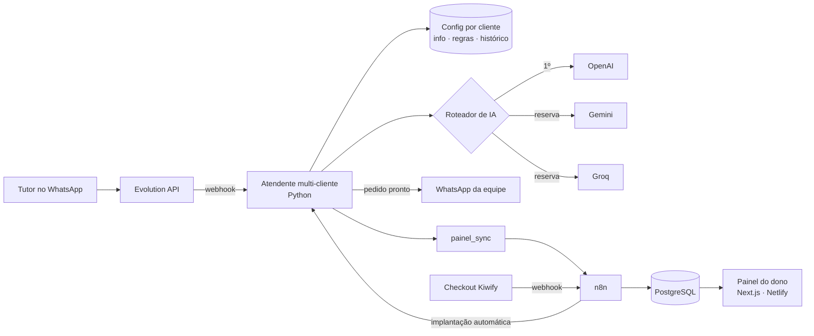

# PataZap · atendimento com IA no WhatsApp para pet shops

`EM PRODUÇÃO (piloto)` · **Estudo de caso.** O código-fonte é proprietário e não está neste repositório.

> *EN: Multi-tenant SaaS that answers pet shop customers on WhatsApp with AI, collects booking requests and hands off to the team. Python services, n8n, Evolution API, PostgreSQL, Next.js.*

**🔗 Demonstração pública:** [patazap.netlify.app/demo](https://patazap.netlify.app/demo) (WhatsApp simulado, central da recepção e painel do dono, com dados de exemplo)

---

## O problema

Pet shops e banho e tosa perdem cliente no WhatsApp: a mensagem chega no meio do banho, ninguém responde por horas e o tutor fecha com o concorrente. Contratar recepcionista só para isso não cabe no orçamento de um negócio pequeno.

## A solução

Uma atendente de IA por cliente, ligada ao WhatsApp do pet shop. Ela:

- responde dúvidas com as informações daquele estabelecimento (serviços, preços, horários, endereço)
- entende **áudio** (transcrição automática)
- monta o **pedido de horário** e manda para a equipe confirmar com um toque. A IA nunca confirma horário sozinha
- passa para uma pessoa quando o assunto é saúde do animal, reclamação ou remarcação
- **pausa sozinha** quando alguém da equipe assume a conversa

O dono recebe um **painel** com conversas, pedidos e um relatório mensal no WhatsApp.

## Arquitetura

## Decisões técnicas

| Desafio | Como resolvi |
|---|---|
| Vários pet shops no mesmo servidor | Cada cliente tem pasta, configuração, histórico e token de painel próprios. Nada é compartilhado entre clientes |
| IA cai ou estoura cota | Roteador com 3 provedores em cascata e **teto de gasto mensal** com aviso automático |
| IA "inventar" horário | Regra no código, além do prompt: o pedido só vira agendamento depois que a equipe confirma |
| Humano e robô respondendo juntos | Detecção da última mensagem humana no histórico: pausa de 24 h |
| Venda → cliente funcionando | Checkout dispara webhook → formulário de implantação → o servidor cria o cliente e manda as boas-vindas sem intervenção manual |
| Saber se o robô parou | Vigia a cada 10 min + alerta no WhatsApp do operador |
| Melhorar com o uso | Revisão noturna das conversas por uma IA revisora, que sugere ajustes nas regras de atendimento |

## Stack

## O que não está aqui (de propósito)

Prompts, regras de atendimento, fluxos do n8n e o código dos serviços. Este repositório mostra **o que foi construído e como**. A implementação é proprietária.

---

Projeto de [Leonardo Magalhães](https://github.com/leomagalhaesti) · [LinkedIn](https://www.linkedin.com/in/leomagalhaesti/)
